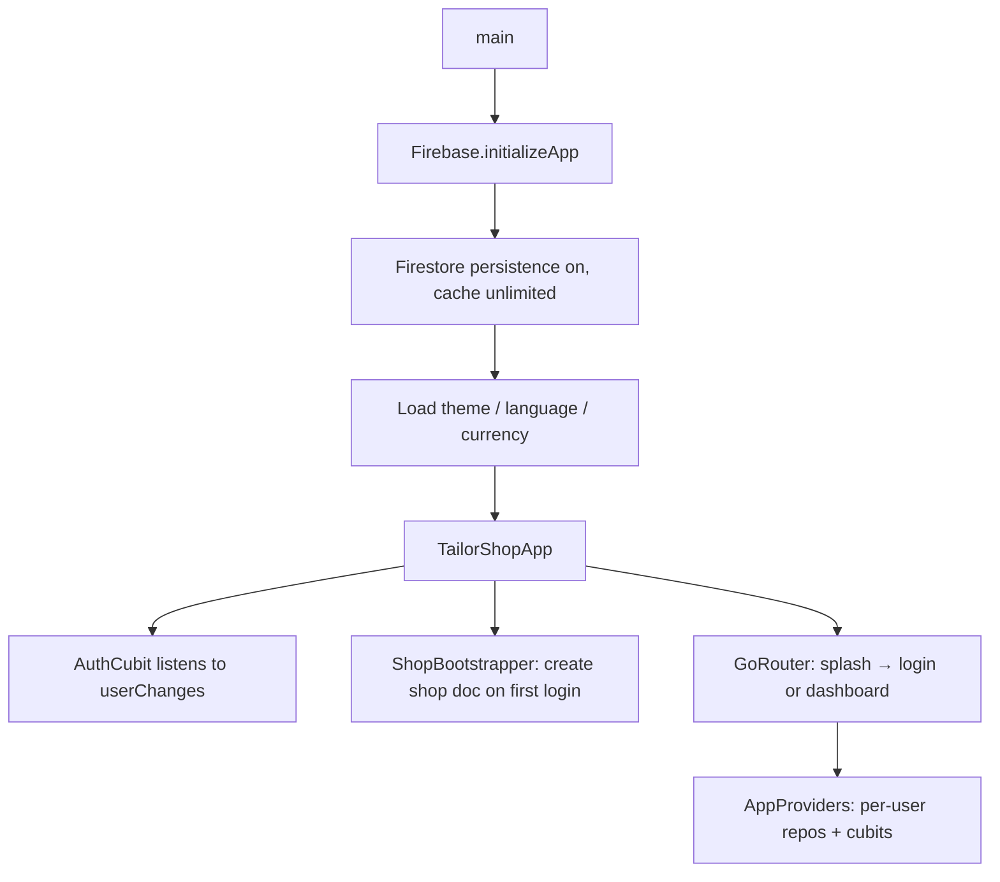
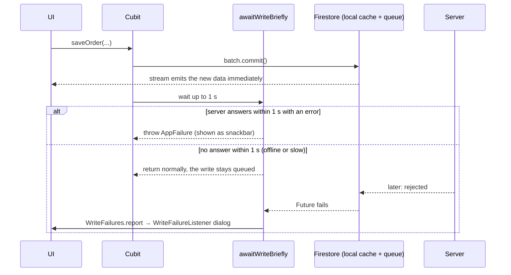

# Architecture

How the app is put together, from `main()` to a Firestore write. Read this before changing anything that crosses a feature boundary.

## Layers

The code is organised **feature-first** (`lib/features/<feature>/`), and each feature is split into the same three layers:

```text
presentation/screens, widgets   Flutter UI. Reads cubit state, calls cubit methods.
presentation/cubit              State + business rules (validation, money checks).
data/                           Models, repositories, pure-Dart calculators.
```

Rules that hold everywhere:

| Rule | Why |
|---|---|
| Only repositories import `cloud_firestore` / `firebase_auth` for reads and writes. Paths and watched queries come from [ShopCollections](../lib/core/data/shop_collections.dart). | One place to change paths, queries and batches. |
| Nothing under `features/*/data/` imports `material.dart`, `widgets.dart` or `core/theme/`. Checked by [architecture_test.dart](../test/architecture_test.dart). | Stored ids are never tied to how they look. Icons and colours live in presentation extensions ([order_status_ui.dart](../lib/features/orders/presentation/order_status_ui.dart), [payment_method_ui.dart](../lib/features/payments/presentation/payment_method_ui.dart)) and in the measurement icon registry. |
| All money maths goes through `OrderMoney` (and `LedgerCalculator` for sums across orders). | Balances are computed one way, and the security rules check the same formula. |
| Only `PaymentRepository` changes `totalPaid`: recording or voiding a payment, and creating an order with an advance. | Every money change is one batch that writes the payment and the order together, which is what the rules require. |
| Screens never show raw exceptions. Cubits throw `AppFailure`, whose `message` is safe to display. | Error text is translated and written for a shop owner. |
| Derived fields (`nameLower`, `phoneNormalized`, `remainingAmount`, `paymentStatus`) are recomputed from their sources, never trusted from storage. | They can never drift from the fields they come from. |

### Pure-Dart logic

These classes have no Flutter UI and no Firebase calls, so they can be unit-tested directly:

| Class | File | Responsibility |
|---|---|---|
| `OrderMoney` | [order_money.dart](../lib/features/orders/data/order_money.dart) | Line totals, order total, remaining, Paid/Partial/Unpaid |
| `LedgerCalculator` | [ledger_calculator.dart](../lib/features/payments/data/ledger_calculator.dart) | Per-customer balances, outstanding list, shop total outstanding (cancelled orders excluded) |
| `DashboardSummary` | [dashboard_summary.dart](../lib/features/dashboard/data/dashboard_summary.dart) | Every dashboard number, in one pass over in-memory data |
| `ReportSummary` | [report_summary.dart](../lib/features/reports/data/report_summary.dart) | Period ranges, income by day/month and by method, orders by status, top customers |
| `InchFormat` | [inch_format.dart](../lib/core/utils/inch_format.dart) | Parse `15`, `15.5`, `15 1/2`, `15½`; display exact eighths as fractions |
| `PhoneUtils` | [phone_utils.dart](../lib/core/utils/phone_utils.dart) | Normalise `+92 300…` / `0092 300…` to `0300…` for duplicate detection |
| `AppDates` | [app_dates.dart](../lib/core/utils/app_dates.dart) | Whole-day dates, calendar-safe `addDays`, localised month/weekday names |

## Startup sequence

[main.dart](../lib/main.dart) runs these steps in order:

1. Keep the native splash on screen (`FlutterNativeSplash.preserve`).
2. Install error handlers: errors are logged with `debugPrint`; in release builds `ErrorWidget` is replaced by a calm translated message.
3. `Firebase.initializeApp` using the generated `lib/firebase_options.dart`.
4. Enable Firestore offline persistence with an **unlimited cache**. This must happen before any other Firestore call.
5. Load device preferences from `SharedPreferences`: theme (`ThemeController`), language (`LocaleController`), display currency (`CurrencyController`).
6. `runApp(TailorShopApp)`, which creates the app-lifetime objects once: `AuthRepository`, `ShopRepository`, `AuthCubit`, `ShopBootstrapper` and the `GoRouter`.



## Object lifetimes

| Scope | Objects | Created in |
|---|---|---|
| App lifetime | `AuthRepository`, `ShopRepository`, `AuthCubit`, `ShopBootstrapper`, `GoRouter` | `_TailorShopAppState.initState` |
| App lifetime (singletons) | `ThemeController`, `LocaleController`, `CurrencyController`, `WriteFailures` | Static `instance` / static stream |
| While signed in | `CustomerRepository`, `MeasurementRepository`, `OrderRepository`, `PaymentRepository`, `SyncRepository` and their cubits | [app_providers.dart](../lib/features/shell/presentation/widgets/app_providers.dart) |

`AppProviders` wraps the whole navigation shell. The `MultiBlocProvider` is keyed by the user's uid, so a different user signing in gets brand-new cubits and never sees the previous user's data. The shop id passed to every cubit **is** the uid.

## State management

Every data feature uses the same Cubit pattern:

- On creation, the cubit subscribes to the repository's `watch…()` stream of the **whole collection** and emits `loading` → `loaded` (or `failure` with a friendly message). `retry()` re-subscribes.
- Search and filters (`setQuery`, `setFilter`, `toggleArchived`, `setGarmentFilter`) only change state. Filtering happens on the device over the in-memory list, which gives "contains" matching, works offline and costs no extra reads.
- Write methods (`saveCustomer`, `saveOrder`, `recordPayment`, ...) validate, build the model, call the repository through `awaitWriteBriefly`, and return the id. They throw `AppFailure` for anything the user must fix.

The UI never waits for a write to reach the server. The local Firestore cache updates the stream immediately, so the screen already shows the change.

## Offline writes

A Firestore write's `Future` only completes once the **server** confirms it, which can take hours offline. [offline_write.dart](../lib/core/utils/offline_write.dart) handles this:



`WriteFailureListener` (mounted inside `AppProviders`) shows at most one "change not saved" dialog at a time.

## Sync indicator

[SyncCubit](../lib/features/sync/presentation/cubit/sync_cubit.dart) listens to snapshot **metadata** of the four shop collections. `SyncRepository` takes its queries from `ShopCollections.allWatched`, the same ones the data repositories watch. Firestore therefore shares the listeners and no extra documents are read. `ShopCollections` is also the one place to add a "recent history only" window if a shop ever outgrows loading everything.

| Condition (any collection) | Status | Shown after |
|---|---|---|
| `isFromCache` | `offline` | 3 s |
| `hasPendingWrites` | `syncing` | 1.5 s |
| neither | `synced` | immediately |

The delays stop the banner flashing at launch (the cache answers first) and on normal online saves (pending for a split second). [SyncBanner](../lib/features/sync/presentation/widgets/sync_banner.dart) renders the status.

## Shop bootstrap

[ShopBootstrapper](../lib/features/shop/data/shop_bootstrapper.dart) listens to `AuthCubit`. The first time each uid is seen as authenticated, it calls `ShopRepository.ensureShopExists`, which creates `shops/{uid}` named after the user's display name. Nothing waits for it, and failures (for example, offline on the very first launch) are logged and retried on the next launch. The rest of the app does not depend on the shop document existing; only the shop name in Settings does.

## Navigation

[app_router.dart](../lib/core/router/app_router.dart) builds one `GoRouter`.

**Redirects** run on auth-status changes and when the splash finishes:

| State | Behaviour |
|---|---|
| Splash animation not finished (`SplashGate` closed) | Stay on `/splash` |
| `AuthStatus.unknown` | Stay on `/splash` |
| `unauthenticated` | Only `/login`, `/signup`, `/forgot-password` are allowed; anything else goes to `/login` |
| `authenticated` | Auth routes and splash go to `/dashboard` |

**Shell branches** (`StatefulShellRoute.indexedStack`). The index order must match `branchIndex` in [app_shell.dart](../lib/features/shell/presentation/screens/app_shell.dart).

| # | Path | Screen | Nested routes |
|---|---|---|---|
| 0 | `/dashboard` | Dashboard | |
| 1 | `/customers` | Customers list | `new`, `:id`, `:id/edit`, `:id/measurements/new?garment=`, `:id/measurements/:mid[/edit]`, `:id/orders/new`, `:id/orders/:oid[/edit]` |
| 2 | `/measurements` | All measurement sets | `new?customerId=&garment=`, `:mid`, `:mid/edit` |
| 3 | `/orders` | Orders list | `new?customerId=`, `:oid`, `:oid/edit` |
| 4 | `/ledger` | Outstanding balances | `:customerId` (customer ledger) |
| 5 | `/reports` | Reports | |
| 6 | `/settings` | Settings | |
| 7 | `/more` | Mobile "More" menu (Measurements, Reports, Settings) | |

Static `new` routes are declared **before** `:id` routes so `new` is not read as an id. Always build paths with the helpers in [app_routes.dart](../lib/core/router/app_routes.dart) rather than string literals.

**Adaptive shell** ([breakpoints.dart](../lib/core/responsive/breakpoints.dart)):

| Width | Layout | Destinations |
|---|---|---|
| < 600 | Bottom bar | Home, Customers, Orders, Ledger, More |
| 600 to 1023 | Navigation rail | All seven main sections |
| ≥ 1024 | Sidebar | All seven main sections |

## Localisation

The app uses its own lightweight string table rather than `gen-l10n`/ARB files.

- [app_strings.dart](../lib/core/l10n/app_strings.dart) defines `AppLanguage` (supported languages) and `S`, accessed as `S.current.someKey` with no `BuildContext`.
- Each language is a `Map<String, String>` inside `S._data`. Roman Urdu lives in its own file, [app_strings_ru.dart](../lib/core/l10n/app_strings_ru.dart).
- A missing key falls back to English, then to the key itself.
- Placeholders use `{name}` and are filled by `_p`. Plurals use `key#one`, `key#two` and `key#other`.
- Values stored in Firestore (order status, payment method, garment type, field keys, style options) are translated with `S.current.dyn('<prefix>.<id>', englishFallback)`. Prefixes: `order.`, `pay.`, `method.`, `garment.`, `field.`, `hint.`, `range.`.

| Code | Language | Direction | Flutter locale |
|---|---|---|---|
| `en` | English | LTR | `en` |
| `ur` | Urdu | RTL | `ur` |
| `ru` | Roman Urdu | LTR | `en` |
| `ar` | Arabic | RTL | `ar` |
| `zh` | Chinese | LTR | `zh` |
| `hi` | Hindi | LTR | `hi` |

When the language or currency changes, `TailorShopApp` calls `setState` and then marks **every element** in the tree for rebuild. Many widgets hold `S.current…` strings that Flutter would not otherwise refresh. This is a deliberate trade-off. Switching to `S.of(context)` would mean touching about a thousand call sites. Rebuilding in place, unlike rebuilding with a new key, keeps half-filled forms and the navigation stack intact.

[translations_test.dart](../test/translations_test.dart) keeps the tables honest:
- no language may contain a key English lacks;
- `{placeholders}` must match English;
- plurals need an `#other` form.

Untranslated keys fall back to English at runtime. The ones that exist today are listed in `test/l10n_missing_allowlist.txt`, so a *new* gap fails the test.

> `ru` here means Roman Urdu, not Russian. See [review.md](review.md#language-code-ru-is-used-for-roman-urdu).

## Measurement icons

Measurement fields, garment types and style options use custom **garment-diagram icons** in [lib/features/measurements/presentation/icons/](../lib/features/measurements/presentation/icons/), not Material icons. Each icon draws the garment in a muted colour and the part being measured (or the chosen style) in the brand colour, so a tailor can see where the tape goes.

| File | Role |
|---|---|
| `tailor_glyph.dart` | Data types. `TailorGlyph` has `body` shapes (stroked and lightly filled), `lines` (seams) and accent `marks`. The marks are `Span` (dimension line with arrows), `Tape` (bowed line around the body), `Ring` (collar, armhole), `Accent` (free path, optionally filled) and `Dot` (button). Paths use SVG-style `M L Q C Z` strings on a 24 × 24 grid. |
| `tailor_icon.dart` | `TailorIcon(glyph, size:)` paints a glyph. Outline defaults to `pal.slate500`, accent to `pal.primary`, so it follows light and dark themes. It is excluded from screen readers unless given a `semanticLabel`, because a text label always sits beside it. It is not mirrored in RTL. |
| `tailor_glyphs.dart` | The registry: `garment(type)`, `field(type, key)`, `style(type, group, option)`. Keyed by the permanent template ids and **per garment**, because "length" on a kurta and on a shalwar are different drawings. Unknown ids get `fallback`, a tape measure, so an icon is never blank. |

[tailor_glyphs_test.dart](../test/icons/tailor_glyphs_test.dart) fails if any template field or style option lacks its own drawing. [tailor_icons_golden_test.dart](../test/icons/tailor_icons_golden_test.dart) renders the whole set to PNGs in `test/icons/goldens/` for review.

## Theming and currency

- [app_theme.dart](../lib/core/theme/app_theme.dart) defines Material 3 light and dark themes using the bundled **Inter** font. [app_palette.dart](../lib/core/theme/app_palette.dart) provides semantic colours through `context.pal`. `ThemeController` stores Light / Dark / System.
- `CurrencyController` stores one of ten display currencies (PKR default). It changes **only how amounts look**: amounts are stored as plain integers and nothing is converted. PKR, INR and BDT use lakh grouping (`1,00,000`). `Money.pkr(amount, {currency})` uses the Settings choice unless a currency is passed, which is how the tests format without depending on device state.
- `MaterialApp.builder` clamps text scaling to 1.0–1.5× so very large system font sizes do not break layouts.

All three preferences are per device (`SharedPreferences`), not per shop.
